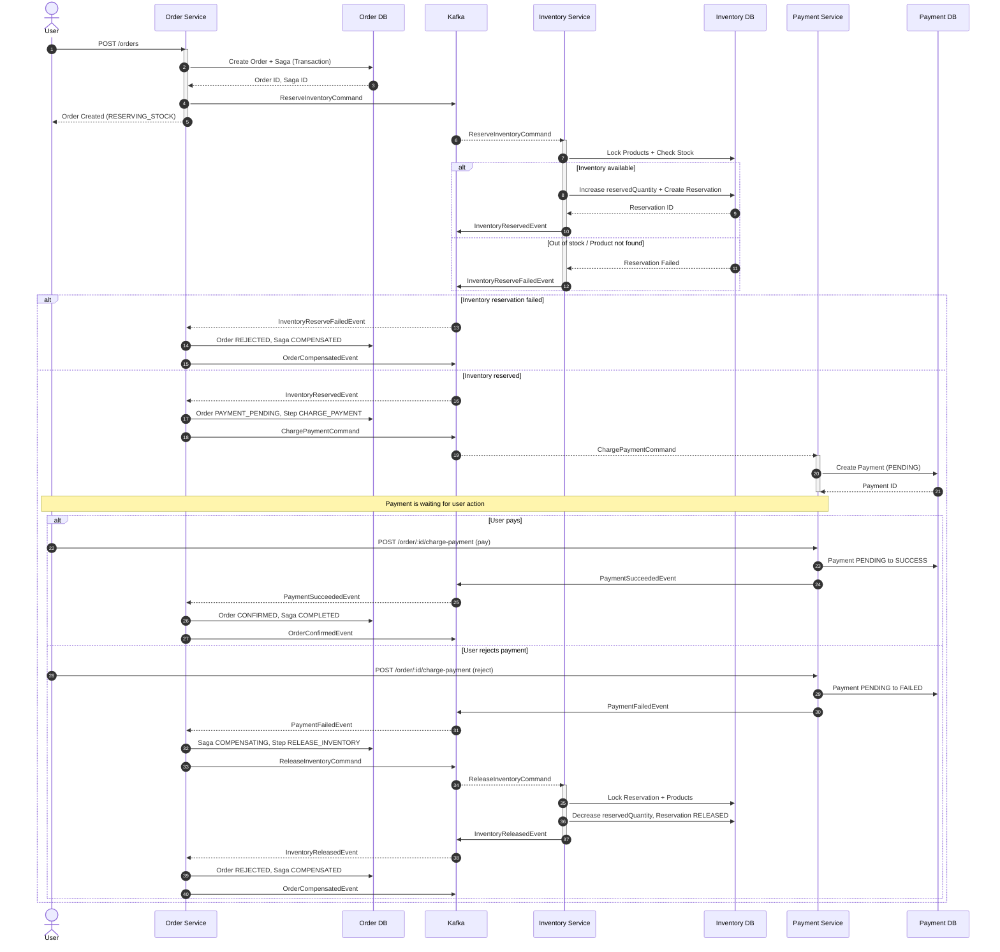

### Mô tả 

- ứng dụng học Kafka cơ bản 
- Sử dụng Luồng Order để học microservice
- Không service Discovery , gateway 

### Saga 

- Orchestraion

- entity Kafka 
  - Chỉ lưu current Step
  - Update currentStep sau mỗi step

### Phase 

## Phase 1: Basic Saga Orchestration [x]
- [x] Order → Inventory → Payment
- [x] Saga state persistence
- [x] Compensation flow

## Phase 2: Reliability
- [x] Business idempotency (basic)
- [x] Transactional Outbox
- [x] Outbox retry, lease & recovery
- [ ] Consumer retry & failure handling
- [ ] Inbox pattern
- [ ] Dead Letter Queue (DLQ)
- [ ] Message ordering
- [ ] Integration & failure testing

###  Luồng thực thi

### Transactional Outbox

- Mô hình: polling Publisher: Worker định kì truy vấn Outbox và Publish Message
- Bảng Outbox lưu toàn bộ Event message mà cần service publishj một cách đáng tin cậy
- Mỗi service nên quản lý outbox trong database mà nó sở hữu `outbox_messages`
- Sử dụng lưu trữ full payload để chuẩn bị gửi luôn
- 
### Các trường 

- `id` -> định danh outbox
- `topic` -> Kafka topic cần publish
- `message_key` -> Kafka key thương là orderId
- payload: Toàn bộ message dưới dạng JSONB
- status: 
- attempts
- createdAt
- publishedAt
- next_retry_at

### Các trường hợp cần cân nhắc

- Extractly-once delivery
- tránh giữ database transaction quá lâu
- thứ tự message cần được cân nhắc riêng